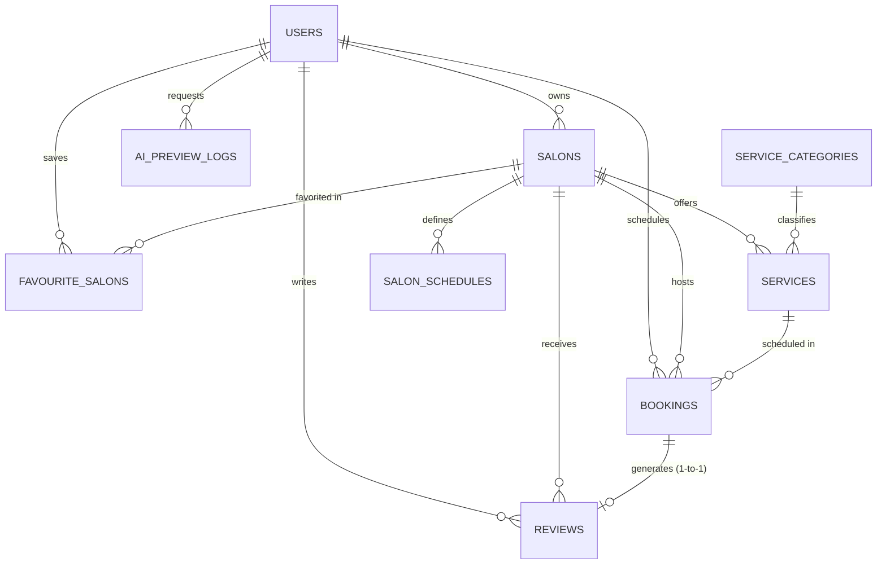

# Database Design & Schema Specification

## Database Engine: PostgreSQL 16 (with SQLite local zero-config fallback)

### 1. Entity-Relationship (ER) Diagram

---

### 2. Relational Table Specifications

#### A. `users`
| Column | Type | Constraints | Description |
| :--- | :--- | :--- | :--- |
| `id` | INTEGER | PRIMARY KEY, AUTOINCREMENT | Unique user identifier |
| `email` | VARCHAR(255) | UNIQUE, NOT NULL, INDEXED | Normalized login email |
| `hashed_password` | VARCHAR(255) | NOT NULL | Salted Bcrypt password hash |
| `full_name` | VARCHAR(255) | NOT NULL | User's full name |
| `phone` | VARCHAR(20) | NULLABLE | Contact telephone |
| `role` | VARCHAR(50) | NOT NULL, DEFAULT 'CUSTOMER' | GUEST, CUSTOMER, SALON_OWNER, ADMIN |
| `is_active` | BOOLEAN | NOT NULL, DEFAULT TRUE | Soft-activation status flag |
| `created_at` | TIMESTAMP | NOT NULL, DEFAULT UTC | Account creation timestamp |
| `updated_at` | TIMESTAMP | NOT NULL, DEFAULT UTC | Profile modification timestamp |

#### B. `salons`
| Column | Type | Constraints | Description |
| :--- | :--- | :--- | :--- |
| `id` | INTEGER | PRIMARY KEY, AUTOINCREMENT | Unique salon identifier |
| `owner_id` | INTEGER | FK -> `users.id`, CASCADE, NOT NULL | Owner user reference |
| `name` | VARCHAR(255) | NOT NULL, INDEXED | Business display name |
| `description` | TEXT | NULLABLE | Business profile & amenities |
| `address` | VARCHAR(500) | NOT NULL | Physical street address |
| `city` | VARCHAR(100) | NOT NULL, INDEXED | City (e.g. Mumbai, Bengaluru) |
| `locality` | VARCHAR(100) | NOT NULL, INDEXED | Locality/Area (e.g. Bandra, Indiranagar) |
| `pincode` | VARCHAR(20) | NOT NULL | Postal index number |
| `latitude` | FLOAT | NULLABLE | Decimal latitude coordinate |
| `longitude` | FLOAT | NULLABLE | Decimal longitude coordinate |
| `phone` | VARCHAR(30) | NOT NULL | Salon contact telephone |
| `email` | VARCHAR(255) | NULLABLE | Public business email |
| `cover_image` | VARCHAR(1000)| NOT NULL | Hero facade/interior image URL |
| `gallery_images`| TEXT | NULLABLE, DEFAULT '[]' | JSON array of interior photo URLs |
| `rating` | FLOAT | NOT NULL, DEFAULT 0.0, INDEXED | Aggregate rating (1.0 to 5.0) |
| `review_count`| INTEGER | NOT NULL, DEFAULT 0 | Count of verified customer reviews |
| `is_active` | BOOLEAN | NOT NULL, DEFAULT TRUE | Visibility flag |
| `created_at` | TIMESTAMP | NOT NULL, DEFAULT UTC | Onboarding timestamp |
| `updated_at` | TIMESTAMP | NOT NULL, DEFAULT UTC | Modification timestamp |

#### C. `service_categories`
| Column | Type | Constraints | Description |
| :--- | :--- | :--- | :--- |
| `id` | INTEGER | PRIMARY KEY, AUTOINCREMENT | Category identifier |
| `name` | VARCHAR(100) | UNIQUE, NOT NULL | Display name (e.g. Hair Care) |
| `slug` | VARCHAR(100) | UNIQUE, NOT NULL, INDEXED | URL slug (e.g. hair-care) |
| `icon` | VARCHAR(100) | NULLABLE | Lucide icon identifier |
| `display_order` | INTEGER | NOT NULL, DEFAULT 0 | Navigation sort order |

#### D. `services`
| Column | Type | Constraints | Description |
| :--- | :--- | :--- | :--- |
| `id` | INTEGER | PRIMARY KEY, AUTOINCREMENT | Service identifier |
| `salon_id` | INTEGER | FK -> `salons.id`, CASCADE, NOT NULL | Associated salon |
| `category_id` | INTEGER | FK -> `service_categories.id`, RESTRICT | Classification category |
| `name` | VARCHAR(255) | NOT NULL, INDEXED | Specific service title |
| `description` | TEXT | NULLABLE | Service details & inclusions |
| `price` | FLOAT | NOT NULL, INDEXED | **Exact service price in INR (₹)** |
| `duration_minutes` | INTEGER | NOT NULL, DEFAULT 30 | Service duration in minutes |
| `is_active` | BOOLEAN | NOT NULL, DEFAULT TRUE | Service availability toggle |

#### E. `salon_schedules`
| Column | Type | Constraints | Description |
| :--- | :--- | :--- | :--- |
| `id` | INTEGER | PRIMARY KEY, AUTOINCREMENT | Schedule identifier |
| `salon_id` | INTEGER | FK -> `salons.id`, CASCADE, NOT NULL | Target salon |
| `day_of_week` | INTEGER | NOT NULL (0=Mon, 6=Sun) | Day indicator |
| `open_time` | TIME | NOT NULL | Opening time |
| `close_time` | TIME | NOT NULL | Closing time |
| `is_closed` | BOOLEAN | NOT NULL, DEFAULT FALSE | Full day closure flag |
| `slot_duration_minutes` | INTEGER | NOT NULL, DEFAULT 30 | Appointment interval step |
| `concurrent_capacity` | INTEGER | NOT NULL, DEFAULT 2 | Number of concurrent stylist chairs |
| *Constraint* | `uq_salon_day` | UNIQUE (`salon_id`, `day_of_week`) | Single schedule rule per day |

#### F. `bookings`
| Column | Type | Constraints | Description |
| :--- | :--- | :--- | :--- |
| `id` | INTEGER | PRIMARY KEY, AUTOINCREMENT | Booking identifier |
| `booking_reference` | VARCHAR(50) | UNIQUE, NOT NULL, INDEXED | Public reference (e.g. `SLN-2026-X9Y2A`) |
| `customer_id` | INTEGER | FK -> `users.id`, CASCADE, NOT NULL | Scheduling customer |
| `salon_id` | INTEGER | FK -> `salons.id`, CASCADE, NOT NULL | Target salon |
| `service_id` | INTEGER | FK -> `services.id`, RESTRICT, NOT NULL | Exact booked service |
| `booking_date` | DATE | NOT NULL, INDEXED | Appointment date |
| `start_time` | TIME | NOT NULL | Slot start time |
| `end_time` | TIME | NOT NULL | Calculated slot completion time |
| `total_price` | FLOAT | NOT NULL | Locked service price |
| `status` | VARCHAR(50) | NOT NULL, DEFAULT 'CONFIRMED' | PENDING, CONFIRMED, COMPLETED, CANCELLED |
| `customer_notes` | TEXT | NULLABLE | Client special requests |
| `cancellation_reason`| TEXT | NULLABLE | Reason logged upon cancellation |

#### G. `reviews`
| Column | Type | Constraints | Description |
| :--- | :--- | :--- | :--- |
| `id` | INTEGER | PRIMARY KEY, AUTOINCREMENT | Review identifier |
| `booking_id` | INTEGER | FK -> `bookings.id`, CASCADE, UNIQUE | Enforces 1 review per completed visit |
| `customer_id` | INTEGER | FK -> `users.id`, CASCADE, NOT NULL | Verified review author |
| `salon_id` | INTEGER | FK -> `salons.id`, CASCADE, NOT NULL | Reviewed salon |
| `rating` | INTEGER | NOT NULL (1 to 5) | Star rating score |
| `comment` | TEXT | NULLABLE | Detailed feedback |
